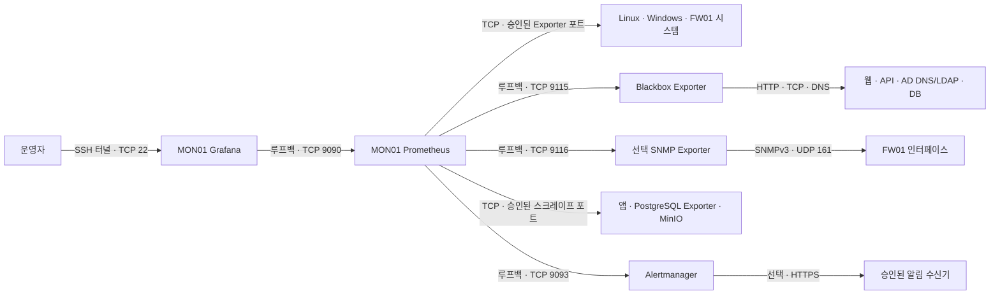

# 통합 인프라 모니터링

MON01에서 Prometheus가 메트릭을 수집하고 Grafana가 대시보드 6개를 제공합니다. Prometheus 규칙이 장애를 판정하고 Alertmanager가 알림을 묶어 전송합니다.

## 현황과 활성화 기준

2026-11-20, 저장소의 기본 브랜치와 협업 문서를 확인했다. 아래 주소와 역할은 프로젝트 자료에 기재된 값이다. 작업 PC에서 MON01, APP01, PIPE01, DB01의 ICMP 응답은 확인했다. SSH 및 점검한 후보 서비스 포트는 TCP 연결을 거부했다. 서버 운영체제, 서비스 실행 여부, Exporter 설치 여부, MON01 잔여 자원은 콘솔 또는 기존 관리 경로에서 확인해야 한다.

| 서버 | 자료의 주소 | 확인할 메트릭·점검 |
| --- | --- | --- |
| FW01 | 미확인. 자료 표기 ‘임시 잠금’ | FreeBSD Exporter, 기존 SNMPv3와 IF-MIB |
| DC01 | 미확인 | Windows Exporter, NTDS/DNS/Netlogon/Kdc, 내부 DNS 레코드, LDAP TCP |
| WEB01 | 미확인. 자료의 `192.168.151`은 유효한 IPv4가 아님 | Linux Exporter, 포털 또는 프록시 헬스, 요청 계측 |
| APP01 | `192.168.0.158` | Linux Exporter, RAG API 헬스, 인증 의존성 헬스, 요청 계측 |
| PIPE01 | `192.168.0.157` | Linux Exporter, 파이프라인 헬스, 문서 처리 계측 |
| DB01 | `192.168.0.159` | Linux Exporter, PostgreSQL/Exporter, Qdrant와 MinIO 헬스, MinIO 메트릭 |
| MON01 | `192.168.0.156` | Linux Exporter, 중앙 모니터링 구성요소, 디스크와 시계열 수 |

Ubuntu 서버에서 `bash inventory.sh`를 실행해 서비스, 리스너, 컨테이너, 메모리와 저장 공간을 확인한다. DC01에서는 `inventory-dc.ps1`을 실행한다. FW01과 WEB01의 IP는 VM 콘솔·VM NIC 정보 또는 관리자가 확인한 DHCP/DNS 자료로 확인한다. FW01 플러그인과 서비스는 OPNsense 관리 UI에서 조회한다. 기존 모니터링 구성이나 알림·로그 에이전트가 있으면 대상별로 재사용 경로를 정한다. 기존 중앙 스택을 재사용할 경우 운영자가 기존 구성에 이 규칙과 대시보드를 병합하고 기존 데이터와 타깃을 유지한다.

`inventory.json`의 `reported_ip`는 참고값이다. 실제 수집 활성화는 `site.json`의 `targets`로만 관리한다. `cp site.example.json site.json` 후 MON01에서 도달성과 응답을 확인한 값만 추가한다. 값 `null`은 점검 비활성화, HTTP 점검은 전체 URL, TCP·DNS·SNMP는 `host:port`, Exporter는 `host:port` 또는 TLS와 경로가 포함된 전체 URL이다. 장비 이동 시 라벨과 대시보드는 유지하고 엔드포인트만 바꾼다.

- **Linux** — 기존 Node Exporter를 우선 사용한다. 설치가 승인된 Ubuntu 호스트에서만 APT 인덱스를 갱신하고 `sudo bash install-node-exporter.sh <승인된 로컬 IPv4>`를 실행한다. MON01 자체는 `127.0.0.1` 바인딩을 사용한다. 다른 호스트는 MON01만 해당 포트로 접근할 수 있는지 먼저 확인한다.
- **Windows** — 기존 Windows Exporter를 사용한다. 필요한 collector는 `cpu,memory,logical_disk,net,service,system`이다. 없을 경우 DC 운영자 승인 후 공식 MSI 및 해당 버전 절차로 설치한다. 서비스 상태 collector를 조회하고 MON01 주소만 Exporter에 접근할 수 있게 운영자가 설정한다. AD 서비스 설정은 변경 전에 별도 승인받는다.
- **FW01** — 지원되는 OPNsense 플러그인과 기존 FreeBSD Node Exporter에서 `node_boot_time_seconds`, `node_load1`을 확인한다. 기존 SNMPv3 경로에 `secrets/snmp.yml`을 준비한다. SNMP Exporter 버전에 맞는 공식 IF-MIB 모듈을 사용하고 `modules.if_mib`, `auths.fw01`에 읽기 전용 `authPriv`를 설정한다. `ifOperStatus`가 숫자 gauge인지 확인한다. FW01 주소와 SNMP 트래픽 허용 여부는 운영자 확인이 필요하다.
- **HTTP 및 인증** — 정상 응답이 2xx이고 리다이렉트 없이 도달하는 헬스 URL을 확인한다. APP01의 인증 연동은 인증 의존성을 확인하는 헬스 엔드포인트가 제공될 때 켠다. LDAP TCP는 리스너 연결 여부를 알려주며 바인드 및 로그인은 별도 검증 대상이다.
- **DNS** — `site.json`의 `dns.name`에 끝에 점이 붙은 내부 FQDN, `dns.type`에 실제 레코드 타입, `dns.answer_pattern`에 예상 응답 RR을 판별하는 RE2 정규식을 입력한다. 예를 들어 AD DNS에서는 관리자 확인을 거친 LDAP SRV 레코드와 대상 DC로 검증한다. Blackbox의 DNS 점검은 NOERROR와 예상 레코드를 모두 요구한다.
- **앱 계측** — 서비스가 실제로 노출하는 지표를 확인한다. 현재 계약은 `http_requests_total{status="200"}` 형태의 요청 카운터, `http_request_duration_seconds_bucket{le="..."}` 히스토그램, `pipeline_documents_total{outcome="..."}` 카운터, `pipeline_last_success_timestamp_seconds` 게이지다. 실제 이름이나 라벨이 다르면 대시보드 및 allowlist를 함께 조정한다. 요청 ID, 문서 ID, 사용자 ID, 원시 URL을 라벨로 쓰지 않는다. 현재 저장소에는 앱 구현이나 계측 코드가 없어 이 지표는 해당 서비스에서 제공할 때 표시된다.
- **DB** — PostgreSQL Exporter의 `pg_up`과 `pg_stat_database_numbackends`를 확인한다. 신규 읽기 권한이나 DB 설정은 DBA가 승인한 후 적용한다. PostgreSQL TCP 점검은 단순 포트 접근이다. Qdrant는 배포된 버전의 준비 상태 URL, MinIO는 배포된 서비스의 헬스 URL을 확인한다. MinIO 사용량은 인증된 v3 `/minio/metrics/v3/cluster/usage/objects`에서 가져온다. 설치 버전이 다른 경우 실제 지표에 맞춰 수정한다.

## 통신 방향

| 출발점 | 목적지 | 프로토콜·포트 |
| --- | --- | --- |
| 운영 PC | MON01 | SSH TCP 22, 승인된 관리 경로 |
| MON01 | Grafana·Prometheus·Alertmanager·Blackbox | TCP 3000·9090·9093·9115, 각 루프백 |
| MON01 | SNMP Exporter | TCP 9116, 루프백, 선택 |
| MON01 | Linux 및 FW01 Exporter | TCP 9100 또는 확인된 포트 |
| MON01 | DC01 Windows Exporter | TCP 9182 또는 확인된 포트 |
| MON01 Blackbox | DC01 DNS 및 LDAP | UDP 53, TCP 389 또는 확인된 포트 |
| MON01 SNMP Exporter | FW01 | UDP 161 또는 확인된 포트 |
| MON01 Blackbox | WEB01·APP01·PIPE01·Qdrant·MinIO | 등록한 HTTP(S) 헬스 URL의 TCP 포트 |
| MON01 | PostgreSQL 및 PostgreSQL Exporter | TCP 5432·9187 또는 확인된 포트 |
| PostgreSQL Exporter | PostgreSQL | 읽기 전용 연결, 승인된 TCP 포트 |
| MON01 | MinIO 메트릭 | TLS 사용을 권장하는 확인된 MinIO API TCP 포트 |
| MON01 Alertmanager | 승인된 Webhook | HTTPS TCP 443 또는 승인된 포트 |

Exporter와 중앙 UI는 인터넷에 공개하지 않는다. 모니터링 워크로드는 전용 내부 경로를 사용하고 대상 ACL은 MON01만 허용한다. TLS 서버 인증서를 검증한다. 기존 OPNsense 정책, AD, DB 보안 설정의 변경은 담당자 사전 승인으로 처리한다.

## MON01 설치와 운영

1. MON01의 실제 OS와 잔여 메모리·디스크를 확인하고, 기존 모니터링 도구 및 포트를 확인한다. 이 Compose 구성은 Linux Docker와 Docker Compose 플러그인이 이미 설치된 MON01용이다. 기존 중앙 스택과 충돌하면 기존 도구를 재사용한다.
2. Git 체크아웃의 이 디렉터리에서 `site.example.json`을 복사하고 승인 및 검증된 타깃을 등록한다. 기존 Docker 관리 권한을 사용한다. 배포 및 Exporter 설치는 운영 담당자 승인 후 진행한다.
3. `secrets/`를 로컬에 만들고 디렉터리에는 필요한 탐색 권한만 부여한다. 각 비밀 파일은 해당 컨테이너의 사용자만 읽을 수 있도록 설정한다. 기본 이미지의 UID를 확인한다. Grafana의 `secrets/grafana-admin`은 초기 암호 파일이며, 일반적인 Grafana UID는 472다. MinIO 토큰은 `secrets/minio-token`, Webhook URL은 `secrets/alert-webhook-url`을 사용한다. Prometheus·Alertmanager의 기본 nobody UID는 보통 65534다. Webhook 파일이 없으면 Alertmanager UI에 경고가 표시되며 외부 전달은 미구성 상태다. 이미 초기화된 Grafana의 암호는 Grafana의 운영 절차로 교체한다.
4. `bash deploy.sh`를 실행한다. Compose와 공식 설정 검증기를 먼저 실행한 뒤 새 런타임 디렉터리로 컨테이너를 시작한다. Grafana 및 Prometheus 데이터, Alertmanager의 상태는 Docker 볼륨에 유지된다. 변경 시 이전 런타임 경로와 이미지 버전을 기록한다. 배포 갱신에는 짧은 수집 공백이 생길 수 있다.
5. 최초 스크레이프와 규칙 평가를 기다린 뒤 `python3 verify.py --runtime runtime/release.XXXXXX`를 실행한다. SSH 접근으로 `ssh -N -L 3000:127.0.0.1:3000 -L 9090:127.0.0.1:9090 -L 9093:127.0.0.1:9093 <운영계정>@<MON01>`을 실행한다. Grafana에서 Infrastructure 폴더의 대시보드 6개를 열고 각 서버·서비스의 성공 응답과 실제 메트릭을 비교한다.

기본 수집은 60초, MinIO와 SNMP는 120초, 규칙 평가는 30초다. Prometheus 보존 한도는 7일 또는 TSDB 블록 4GB이며 WAL과 컨테이너 이미지에 필요한 추가 여유 공간을 별도로 확보한다. 초기 활성 시계열 예산은 10,000개다. 스크레이프별 대상·샘플·레이블 제한과 지표 allowlist를 사용한다. Compose 메모리 상한은 기본 약 1.35GiB이며 SNMP 사용 시 약 1.45GiB다. 배포 후 `docker stats --no-stream`, `free -m`, `df -h`, Overview의 활성 시계열 및 실제 TSDB 사용량을 확인한 다음 타깃을 단계적으로 추가한다. 로그 수집은 기존 rsyslog·Loki·Alloy 등과 자원 사용량 확인 후 별도 변경으로 검토한다.

## 경고와 장애 대응

`rules.yml`에서 임계값과 지속 시간을 변경한다. CPU >85%, 메모리 >90%는 10분, 디스크 >85%는 15분이다. 수집·HTTP·DNS·DB 장애는 3분 유지 후 발화한다. Alertmanager는 경고 이름과 서버별로 그룹화하고 최초 30초 대기, 변경 전달 간격 5분, 반복 4시간을 사용한다. Webhook 설정 시 복구 이벤트도 전달한다.

| 표시 | 의미 | 운영 확인 |
| --- | --- | --- |
| UP | 해당 Exporter 또는 프로토콜 점검 성공 | 항목별 점검 계약과 계측 패널을 확인 |
| DOWN | Exporter 스크레이프 실패 또는 해당 프로토콜 점검 실패 | Prometheus Targets의 오류, VM 콘솔, 리스너, DNS/인증서, 네트워크 ACL을 확인 |
| 데이터 없음 | 구성된 대상의 확인 결과 또는 특정 메트릭이 없음 | 수집 시계열, allowlist, collector, 계측 및 마지막 스크레이프를 확인 |
| 미구성 | 인벤토리에 존재하며 사이트에서 타깃을 활성화하지 않음 | 주소·엔드포인트·접근 승인 확인 후 추가 |

장애·복구 실측은 운영 서비스를 내리는 대신 승인된 별도 테스트 엔드포인트로 수행한다. 정상 응답, 503 또는 타임아웃, 정상 응답 복구 순서로 점검하고 Prometheus Alerts, Alertmanager, Grafana의 전이를 기록한다. 운영에서 수집 실패가 발생하면 먼저 Prometheus Targets와 블랙박스 응답을 확인하고, 이후 대상 서비스 및 ACL을 담당자와 확인한다. 복구 후 연속 두 번의 정상 스크레이프와 경고 해제를 확인한다.

롤백은 이전 릴리스의 `MON_RUNTIME=runtime/release.XXXXXX docker compose up -d`를 사용한다. 이전에 SNMP를 썼다면 `COMPOSE_PROFILES=snmp`도 설정한다. SNMP를 비활성화한 뒤 기존 컨테이너가 남아 있다면 `docker compose --profile snmp stop snmp`로 운영자가 중지한다. Grafana JSON과 프로비저닝 파일은 필요하면 이전 Git 리비전으로 함께 복구한다.

## 로컬 검증

`promtool test rules tests/rules.test.yml`로 설정 상태·DNS·DB·리소스 경고의 규칙 회귀를 확인한다. 공식 Prometheus, Blackbox Exporter, Alertmanager 검증기로 기본 구성과 각 수집 유형을 활성화한 구성을 검사할 수 있다. `python3 tests/smoke.py <prometheus> <blackbox_exporter> --grafana <grafana>`는 임시 루프백 포트와 디렉터리에서 HTTP 정상·503·복구 전이, 알림 규칙, 대시보드 쿼리, Grafana 초기 프로비저닝을 확인한다. Grafana 바이너리가 없으면 `--grafana`를 생략할 수 있다. 운영 점검 대상에는 영향을 주지 않는다.

## 기준 문서

- [Prometheus 구성](https://prometheus.io/docs/prometheus/latest/configuration/configuration/)
- [Blackbox Exporter 구성](https://github.com/prometheus/blackbox_exporter/blob/v0.27.0/CONFIGURATION.md)
- [Grafana 프로비저닝](https://grafana.com/docs/grafana/latest/administration/provisioning/)
- [Windows Exporter collector](https://github.com/prometheus-community/windows_exporter)
- [SNMP Exporter](https://github.com/prometheus/snmp_exporter/tree/v0.30.1)
- [MinIO 메트릭 v3](https://docs.min.io/aistor/operations/monitoring/metrics-and-alerts/metrics-v3/)
